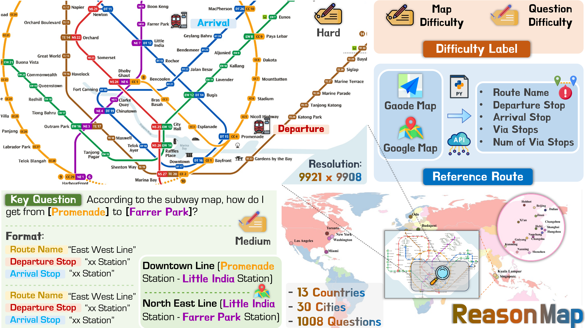

<div align="center">

  <h2><b> [CVPR 2026] ReasonMap: Towards Fine-Grained Visual Reasoning from Transit Maps </b></h2>
  <h4> The first benchmark using real-world metro maps </h4>

</div>


<div align="center">


<a href="https://arxiv.org/abs/2505.18675" target="_blank"></a>
[](https://huggingface.co/collections/FSCCS/reasonmap)


</div>

<div align="center">

**[<a href="https://huggingface.co/papers/2505.18675">HuggingFace Daily Paper</a>]** **[<a href="https://x.com/si_feng32704/status/1927186378900533309">Twitter</a>]** **[<a href="https://mp.weixin.qq.com/s/sPJLQtHgl5DZghWLWa_H3Q">量子位</a>]**

</div>

This repository is for our paper:
> **[ReasonMap: Towards Fine-Grained Visual Reasoning from Transit Maps](https://arxiv.org/abs/2505.18675)** \
> [Sicheng Feng](https://fscdc.github.io/)<sup>1,2,^</sup>, [Song Wang](https://songw-zju.github.io/)<sup>3,2,^</sup>, [Shuyi Ouyang](https://scholar.google.com/citations?user=pQgChLEAAAAJ&hl=zh-CN)<sup>3,2</sup>, [Lingdong Kong](https://ldkong.com/)<sup>2</sup>, [Zikai Song](https://skyesong38.github.io/)<sup>4,2</sup>, [Jianke Zhu](https://person.zju.edu.cn/en/jkzhu)<sup>3</sup>, [Huan Wang](https://huanwang.tech/)<sup>1,*</sup>, [Xinchao Wang](https://sites.google.com/site/sitexinchaowang/)<sup>2</sup> \
> <sup>1</sup>Westlake University, Hangzhou, China \
> <sup>2</sup>National University of Singapore, Singapore \
> <sup>3</sup>Zhejiang University, Hangzhou, China \
> <sup>4</sup>Huazhong University of Science and Technology, Wuhan, China \
> <sup>^</sup>Equal contribution, <sup>∗</sup>Corresponding author: wanghuan@westlake.edu.cn


<!-- ---

<div align="center">

💡 Interested in evaluating your model on ReasonMap or ReasonMap-Plus?
 
📩 Contact us [fscnkucs@gmail.com](fscnkucs@gmail.com)

</div> -->

---
>
> 🙋 Please let us know if you find out a mistake or have any suggestions!
> 
> 🌟 If you find this resource helpful, please consider to star this repository and cite our [research](#citation)!

<p align="center">

</p>


## Updates

- 2026-02-21: 🚀 Our paper was accepted by CVPR 2026! Thanks to all contributors!
- 2026-01-26: 🚀 The following research ([RewardMap](https://github.com/fscdc/RewardMap)) has been accepted by ICLR 2026!
- 2025-09-30: 🚀 We released [ReasonMap-Plus](https://huggingface.co/datasets/FSCCS/ReasonMap-Plus) for the following research - [RewardMap](https://github.com/fscdc/RewardMap)!
- 2025-05-15: 🚀 We released evaluation code and our [website](https://fscdc.github.io/ReasonMap/) online!
- 2025-05-15: 🚀 We released [ReasonMap](https://huggingface.co/datasets/FSCCS/ReasonMap)!


## Usage

### 1. Install dependencies

If you face any issues with the installation, please feel free to open an issue. We will try our best to help you.

```bash
conda env create -f reasonmap-py310.yaml
```

### 2. Dataset
You don't need to download anything by hand. The first time `infer.py` runs, it downloads [ReasonMap](https://huggingface.co/datasets/FSCCS/ReasonMap) (`validation` split = `test` set) and [ReasonMap-Plus](https://huggingface.co/datasets/FSCCS/ReasonMap-Plus) (`test` split) from HuggingFace and caches them. The cache is `~/.cache/huggingface` by default; change it with `HF_HOME` or `--cache-dir`. Everything else ships with this repo: the station tables used for scoring are in `stations/`, and the maps are in `maps/`, which ReasonMap-Plus reads its images from. `score.py` never loads the dataset.

If your GPU nodes have no internet access, fill the cache on a machine that does, then run offline on the nodes:
```bash
python -c "from datasets import load_dataset as l; l('FSCCS/ReasonMap', split='validation'); l('FSCCS/ReasonMap-Plus', split='test')"
export HF_HUB_OFFLINE=1   # on the GPU node, using the same HF_HOME / --cache-dir
```


### 3. Evaluation

Evaluation has two independent stages:

1. **Inference** (`infer.py`) runs a model and writes its raw generations to `outputs/{task}/{model_tag}.jsonl`. Each line holds one sample's generations plus the metadata needed for scoring. Re-running the same command resumes where it stopped.
2. **Scoring** (`score.py`) needs no GPU and no model. It reads those files, writes per-sample results to `results/` (ReasonMap) or `results_plus/` (ReasonMap-Plus), and prints the metrics. You can re-score saved generations any time without running inference again.

`--task reasonmap` runs ReasonMap (short and long route questions), and `--task plus` runs ReasonMap-Plus. Inference can use any of these backends:

| `--backend` | What it runs |
|---|---|
| `hf` | transformers, inside the same process (Kimi-VL, QVQ, Qwen2.5-VL, InternVL3, Skywork-R1V) |
| `vllm` / `sglang` | a vLLM / SGLang server that is already running (OpenAI-compatible API) |
| `openai` | any OpenAI-compatible chat-completions endpoint (`--base-url`) |
| `openai-responses` / `gemini` | OpenAI Responses API / Google Gen AI SDK |

#### 3.1 transformers backend
```bash
python infer.py --task reasonmap --backend hf --model Qwen/Qwen2.5-VL-7B-Instruct
python infer.py --task plus      --backend hf --model Qwen/Qwen2.5-VL-7B-Instruct
python score.py outputs/reasonmap/Qwen2.5-VL-7B-Instruct.jsonl outputs/plus/Qwen2.5-VL-7B-Instruct.jsonl

# batch scripts used in the paper
bash script/run.sh        # ReasonMap, open-source models
bash script/run_plus.sh   # ReasonMap-Plus
```
To run the text-only ablation (the map is not shown to the model), add `--text-only` or append `-onlytext` to the model name.

#### 3.2 vLLM
vLLM and SGLang pin their own torch versions, so install each one in its own environment (`pip install vllm` / `pip install "sglang[all]"`). The client side only needs the `openai` package.

Launch the server:
```bash
vllm serve Qwen/Qwen2.5-VL-7B-Instruct \
    --port 8000 \
    --tensor-parallel-size 1 \
    --max-model-len 32768 \
    --limit-mm-per-prompt '{"image": 1}' \
    --trust-remote-code
```
Once `curl http://localhost:8000/v1/models` responds, run inference and scoring:
```bash
python infer.py --task reasonmap --backend vllm --model Qwen/Qwen2.5-VL-7B-Instruct --num-workers 16
python infer.py --task plus      --backend vllm --model Qwen/Qwen2.5-VL-7B-Instruct --num-workers 16
python score.py outputs/reasonmap/Qwen2.5-VL-7B-Instruct.jsonl outputs/plus/Qwen2.5-VL-7B-Instruct.jsonl
```
Or do all of it, including starting and stopping the server, in one step: `bash script/run_vllm.sh Qwen/Qwen2.5-VL-7B-Instruct` (set `TP=4` for tensor parallelism).

#### 3.3 SGLang
```bash
python -m sglang.launch_server \
    --model-path Qwen/Qwen2.5-VL-7B-Instruct \
    --port 30000 \
    --tp 1 \
    --context-length 32768 \
    --trust-remote-code
```
```bash
python infer.py --task reasonmap --backend sglang --model Qwen/Qwen2.5-VL-7B-Instruct --num-workers 16
python infer.py --task plus      --backend sglang --model Qwen/Qwen2.5-VL-7B-Instruct --num-workers 16
python score.py outputs/reasonmap/Qwen2.5-VL-7B-Instruct.jsonl outputs/plus/Qwen2.5-VL-7B-Instruct.jsonl
```
Or run everything at once with `bash script/run_sglang.sh Qwen/Qwen2.5-VL-7B-Instruct`.

Notes on server backends:
- `--base-url` defaults to `http://localhost:8000/v1` for vLLM and `http://localhost:30000/v1` for SGLang. If the server uses `--served-model-name`, pass that name with `--served-model-name`.
- Maps are sent at their original resolution, so the server's image processor resizes them the same way the transformers backend does. The largest map is about 98 MP. To shrink requests, pass `--max-image-pixels 12845056` (16384×28×28, Qwen2.5-VL's input limit), which downscales maps on the client.
- Sampling settings that are not passed (`--temperature`, `--top-p`, `--top-k`, `--repetition-penalty`) are not sent, so the server falls back to the model's `generation_config`. `--max-tokens` defaults to 2048, the same as the transformers backend.
- Backends are not bit-identical. Kernels differ, so long greedy generations can drift apart, and SGLang handles the `repetition_penalty` from a model's `generation_config` differently (Qwen2.5-VL sets 1.05). In our check with Qwen2.5-VL-3B, SGLang's outputs differed noticeably from transformers and vLLM under the default settings. With `--temperature 0 --repetition-penalty 1.0`, the three backends matched on 80–90% of short answers. Compare models using the same backend and settings.
- Prompting and answer extraction follow the model family: the QVQ system prompt, removal of `<think>` / `◁think▷` reasoning, and the QVQ `\boxed{}` answer. The family is detected from the model name; override it with `--model-family`. If the server runs a reasoning parser, the reasoning trace is still saved, and only the final content is scored.

#### 3.4 Closed models
```bash
export ARK_API_KEY=...      # Doubao (Volcengine Ark)
export OPENAI_API_KEY=...   # o3 / GPT-4o
export GEMINI_API_KEY=...   # Gemini (pip install google-genai)
python infer.py --task reasonmap --preset Doubao-115 --num-workers 4
bash script/run-closed-models.sh
```

#### 3.5 Metrics
`score.py` prints the metrics for the files you pass it. `cal_metrics.py` aggregates every model found under `results/` and `results_plus/`:
```bash
python cal_metrics.py
```

<details>
<summary>Scoring fixes in the refactored evaluator</summary>

Compared with the original evaluation script, the scorer (`reasonmap/scoring.py`) fixes these issues:

1. **Reference arrival stop.** It was built by checking the *departure* stop's suffix, and when that check matched, it fell back to the departure stop's name.
2. **Line names in non-Chinese cities.** Normalization was applied to the model's answer rather than to the reference route, so the reference line name was never compared. Reference names are now mapped onto the station-table keys (`Metro B-Line` → `Line B`, `Sth` → `Southern Line`, `18` → `Line 18`, …).
3. **"Via Stops" parsing.** The list was split on `,` without stripping whitespace, so for the prompted format `A站, B站` only the first stop could ever match.
4. **One line per field.** Each field is now read from its own line, so explanatory text after the last section no longer ends up in "Arrival Stop" or "Via Stops".

Map scores and some accuracies can therefore differ from numbers produced with the original script. On answers that do not trigger these cases, the scores are identical.
</details>

## Citation
If you find this benchmark useful in your research, please consider citing our paper:

```bibtex
@inproceedings{feng2026reasonmap,
  title={ReasonMap: Towards Fine-Grained Visual Reasoning from Transit Maps},
  author={Feng, Sicheng and Wang, Song and Ouyang, Shuyi and Kong, Lingdong and Song, Zikai and Zhu, Jianke and Wang, Huan and Wang, Xinchao},
  booktitle={CVPR},
  year={2026}
}

# further research
@inproceedings{feng2026rewardmap,
  title={RewardMap: Tackling Sparse Rewards in Fine-grained Visual Reasoning via Multi-Stage Reinforcement Learning},
  author={Feng, Sicheng and Tuo, Kaiwen and Wang, Song and Kong, Lingdong and Zhu, Jianke and Wang, Huan},
  booktitle={ICLR},
  year={2026}
}
```
